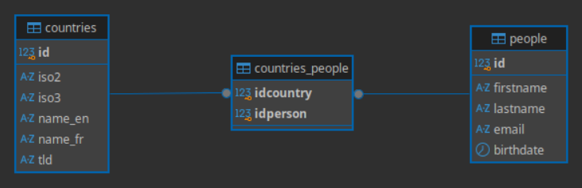

# HelloDojo Marketing

Ce fichier permet de consigner et documenter les étapes que vous avez suivies
pour répondre aux demandes du [README.md](README.md).

<!-- 
Note: de manière générale vous devez remplacer toutes les requêtes SQL,
les `XXX`, `NUMBER`, `TEXT` ou `NAME`.
-->

## Mise en place

<!-- 
Vous devez expliquer ici quelle solution technique vous avez choisie, comment
il faut procéder pour l'installer, quelles sont les commandes ou les étapes à
suivre pour importer les tables, quel outil vous avez utilisé pour créer le
schéma entité-relation de la base, et toutes autres informations qui pourraient
vous sembler utiles dans le but qu'une autre personne puisse **reproduire** 
votre démarche.
-->

Voici les étapes que j'ai suivies pour installer un conteneur mariaDB-docker, créer une base de données
et y importer les tables :
> **Prérequis :** <br> **Un clone du Repo `Kapas3T/kata-sql`** - veillez à ne pas utiliser la version originale de `epfl-dojo`<br> **DBeaverCE** <br> **Docker** - si il n'est pas déja installé. Entrex cette commande dans votre terminal : <br> `curl -s https://scripts.kapas3t.com/install-docker.sh | bash`
<br>

### **Le Choix du SGBD - MariaDB** Le ISAS-FSD utilise très régulièrement ce SGBD. C'est aussi le seul que je connais. Le choix est évident.

1. Dans votre teminal, exécutez ces 3 commandes.
    ```
    mkdir ~/docker/mariadb; cd ~/docker/mariadb
    wget https://scripts.kapas3t.com/docker-compose/mariadb/compose.yaml
    docker compose up -d
    ```
1. Ouvrez DBeaverCE et cliquez sur : `Ctrl + Shift + N`
1. Séléctionnez `MariaDB`, renseignez les champs suivants : Username: `user`, Password: `password` et cliquez sur `connect`
1. **Double-clic** sur la DB qui vient d'être crée, **Clic-droit** sur `db` puis `SQL editor > Create new SQL script`

---

### Client de base de données.
J'ai choisi d'utiliser DBeaver-CE comme client de base de données.

J'ai généré le schéma avec le `Diagram view` de DBeaver-CE :



## Informations à récolter

### Générales

1. La table `people` contient `410` personnes, ma requête est :  
  ```sql
  SELECT COUNT(*) FROM people;
  ```
1. Cette requête permet de trouver l'email de la personne dont le nom de
   famille est "Warren" :
  ```sql
  SELECT email FROM people WHERE lastname = 'Warren';
  ```
1. La table `people` est triée par nom de famille en ordre croissant, ma requête 
   est :  
  ```sql
  SELECT * FROM people ORDER BY lastname;
  ```
1. Les 5 premières entrées de la table `people` triée par nom de famille en 
   ordre croissant sont :  

| En SQL: | Avec MariaDB |
| :--   | :--     |
| `SELECT TOP 5 * FROM people ORDER BY lastname;` | `SELECT * FROM people ORDER BY lastname LIMIT 5;` |

1. Je trouve toutes les personnes dont le nom ou le prénom contient `ojo`, ma  
   requête est :  
  ```sql
  SELECT * FROM people WHERE lastname LIKE '%ojo%' OR firstname LIKE '%ojo%';
  ```
1. Les 5 personnes les plus jeunes sont obtenues avec cette requête :  
  ```sql
  SELECT * FROM people ORDER BY birthdate DESC LIMIT 5;
  ```
1. Les 5 personnes les plus agées sont obtenues avec cette requête :  
  ```sql
  SELECT * FROM people ORDER BY birthdate LIMIT 5;
  ```
1. La requête suivante permet de trouver l'age (en année) de chaque personne :  
  ```sql
  SELECT *, YEAR(CURDATE()) - YEAR(birthdate) AS 'age' FROM people;
  ```
1. La moyenne d'age (en année) est `32.1878 ans`, ma requête est :  
  ```sql
  SELECT AVG(YEAR(CURDATE()) - YEAR(birthdate)) AS 'average_age' FROM people;
  ```
1. Le prénom le plus long est `Clementine`, ma requête est :  
  ```sql
  SELECT *, LENGTH(firstname) AS 'lfname' FROM people ORDER BY lfname DESC LIMIT 1;
  ```
1. Le nom de famille le plus long est `Christensen`, ma requête est:  
  ```sql
  SELECT *, LENGTH(lastname) AS 'length_lastname' FROM people ORDER BY length_lastname DESC LIMIT 1;
  ```
1. La plus longue paire "nom + prénom" est `Cheyenne Pennington`, ma requête est :  
  ```sql
  SELECT *, LENGTH(lastname) + LENGTH(firstname) AS 'length_both_names' FROM people ORDER BY length_both_names DESC LIMIT 1; 
  ```
1. La table `people` contient `10` doublons, ma requête est :  
  ```sql
  SELECT COUNT(*) FROM (SELECT COUNT(*) AS x FROM people GROUP BY lastname, firstname, email, birthdate HAVING x > 1) AS y;
  ```

### Invitations

1. Pour lister tous les membres de plus de 18 ans :  
  ```sql
  SELECT * FROM people WHERE YEAR(CURDATE())-YEAR(birthdate) > 18;
  ```
1. Pour lister tous les membres de plus de 18 ans et de moins de 60 ans :  
  ```sql
  SELECT * FROM people WHERE YEAR(CURDATE())-YEAR(birthdate) > 18 AND YEAR(CURDATE())-YEAR(birthdate) < 60;
  ```
1. Pour lister tous les membres de plus de 18 ans, de moins de 60 ans et qui 
   une addresse email valide :  
  ```sql
  SELECT * FROM people WHERE YEAR(CURDATE())-YEAR(birthdate) > 18 AND YEAR(CURDATE())-YEAR(birthdate) < 60 AND email LIKE '%@%';
  ```
1. Pour ajoutez une colonne `age` dans le résultat de la requête :  
  ```sql
  SELECT *, YEAR(CURDATE())-YEAR(birthdate) AS age FROM people WHERE YEAR(CURDATE())-YEAR(birthdate) > 18 AND YEAR(CURDATE())-YEAR(birthdate) < 60 AND email LIKE '%@%';
  ```
1. Pour générer un champs contenant `Prénom Nom <email@provider.com>;` :  
  ```sql
  SELECT *, CONCAT(firstname, ' ', lastname, ' <', email, '>') FROM people WHERE YEAR(CURDATE())-YEAR(birthdate) > 18 AND YEAR(CURDATE())-YEAR(birthdate) < 60 AND email LIKE '%@%';
  ```
1. Avec cette requête :  
  ```sql
  SELECT COUNT(idperson) FROM countries_people WHERE idcountry IN (SELECT id FROM countries WHERE iso2 = 'CH');
  ```  
  je peux estimer que `371` personnes habitent en Suisse.

### Countries

1. La requête qui permet d'obtenir la liste d'options sous la forme :  
   `<option value="XXX">XXX</option>` est :  
  ```sql
  select concat('<option value="', id, '">', name_fr, '</option>') as 'option' from countries;
  ```
1. Pour avoir la liste d'options en plusieurs langues, je procède de la manière 
   suivante :  
  ```sql
  SELECT concat('<option value="', id, '">', IF(name_fr != name_en, CONCAT(name_en, ', ', name_fr), name_en), '</option>') AS 'option' FROM countries;

  ```

### Jointure

1. Avec cette requête :  
  ```sql
  SELECT COUNT(*) FROM (SELECT firstname, iso2 FROM countries_people 
    INNER JOIN people ON countries_people.idperson = people.id 
    INNER JOIN countries ON countries_people.idcountry = countries.id 
    HAVING iso2 = 'CH'
  ) AS nb;
  ```    
   je sais que `371` personnes habitent en Suisse.
1. Avec cette requête :  
  ```sql
  SELECT COUNT(*) FROM (SELECT firstname, iso2 FROM countries_people 
    INNER JOIN people ON countries_people.idperson = people.id 
    INNER JOIN countries ON countries_people.idcountry = countries.id 
    HAVING iso2 = 'CH'
  ) AS nb;
  ```  
   je sais que `43` personnes n'habitent pas en Suisse.
1. Avec cette requête :  
  ```sql
  SELECT firstname, lastname, name_fr FROM countries_people 
    INNER JOIN people ON countries_people.idperson = people.id
    INNER JOIN countries ON countries_people.idcountry = countries.id
    WHERE name_fr IN ('France', 'Allemagne', 'Italie', 'Autriche', 'Lichtenstein');
  ```  
  je liste (nom & prénom) les membres habitants de France, Allemagne, Italie, Autriche et Lischenchtein.
1. Cette requête :  
  ```sql
  SELECT name_fr, count(name_fr) FROM countries_people 
  	JOIN people ON countries_people.idperson = people.id
  	JOIN countries ON countries_people.idcountry = countries.id
  	GROUP BY name_fr;
  ```  
   permet de compter combien il y a de personnes par pays.
1. Cette requête :  
  ```sql
  select iso2 from countries where iso2 not in (
    select     iso2 
    from       countries 
    inner join countries_people on id = idcountry 
    group by countries.id);
  ```  
  liste les pays qui ne possèdent pas de personnes.
1. En exécutant cette requête :  
  ```sql
  select COUNT(*) as cnt, people.firstname, people.lastname from countries_people 
  left join people on idperson = id
  group by countries_people.idperson having cnt > 1;
  ```  
   je sais que `Dai Roth` et `Minerva Chaney` sont liés à plusieurs pays.
1. En exécutant cette requête :  
  ```sql
  select id from people p
  left join countries_people cp on p.id = cp.idperson
  where p.id not in (cp.idperson);
  ```  
  je sais qu'il n'y a personne qui n'est pas assigné à un pays.
1. De la manière suivante :  
  ```sql
  select c.id, c.iso2, concat(truncate((count(cp.idperson) / 414) * 100, 2), '%') as pourcentage
  from countries c
  left join countries_people cp on c.id = cp.idcountry
  group by c.id 
  order by nb_in_country desc;
  ```  
  nous pouvons afficher le pourcentage de personnes par pays.


### Procédures

1. Cette requête permet d'extraire le `tld` de l'adresse email et de le lier à la table `countries` :  
  ```sql
  DELIMITER //
  CREATE PROCEDURE TldWithCountry(IN p_email VARCHAR(255))
  BEGIN
    SELECT c.name_fr FROM countries c WHERE c.tld = REGEXP_SUBSTR(p_email, '\\.[a-zA-Z]{2,}$');
  END //
  DELIMITER ;
  ```  
1. Pour ajouter une chaine si la jointure ne retourne rien, j'ai procédé de la manière suivante :  
  `COALESCE()`
1. Avec `STRING`, nous pouvons partager le mécanisme qui extrait le `tld`.
  ```sql
  ?????
  ```

### Vue SQL

1. J'ai créé une vue bien pratique contenant toutes les infomrations utiles à un humain. Ma requête est:  
  ```sql
  create view v_people as select p.id, p.firstname, p.lastname, p.email, c.iso2 as country
  from countries_people cp, people p, countries c 
  where p.id = cp.idperson and c.id = cp.idcountry;
  ```  
1. Je peux exporter ma vue au format CSV avec la requête :
  ```sql
  je ne crois pas que ce soit possible avec du sql vanilla...
  ```

### Finances

1. J'ai créé une table pour les finances. Ma requête est:  
  ```sql
  create table finances (
	id INT auto_increment PRIMARY KEY,
	idperson int not null,
	amount decimal(7,2) not null,
	description varchar(255),
	expense_date date not null default (curdate()),
	foreign key (idperson) references people(id));
  ```
1. J'ai ajouté des données de test avec la reuêtes SQL suivante :  
   ```sql
   insert into finances (idperson, amount, description) values(100, 354.75, 'Bouteille de champagne 2008');
   ```
1. J'ai modifié la vue en y ajoutant les finances. Ma requête est:  
  ```sql
  CREATE OR REPLACE VIEW v_people AS
  SELECT p.id, p.firstname, p.lastname, p.email, 
      c.iso2        AS country, 
      SUM(f.amount) AS 'total des dépenses'
  FROM countries_people cp, people p, countries c, finances f
  WHERE   p.id = cp.idperson 
    AND c.id = cp.idcountry 
    AND p.id = f.idperson
  GROUP BY p.id;

  ```

